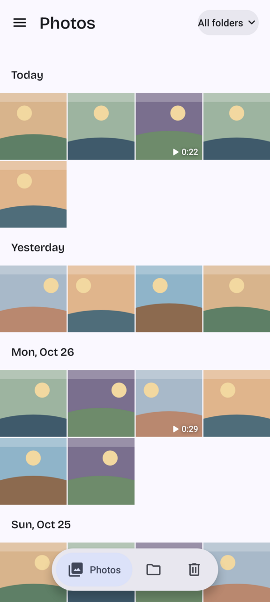
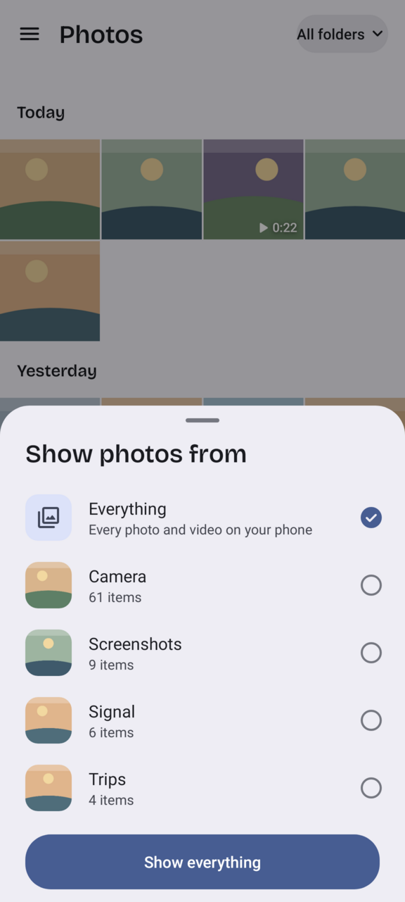
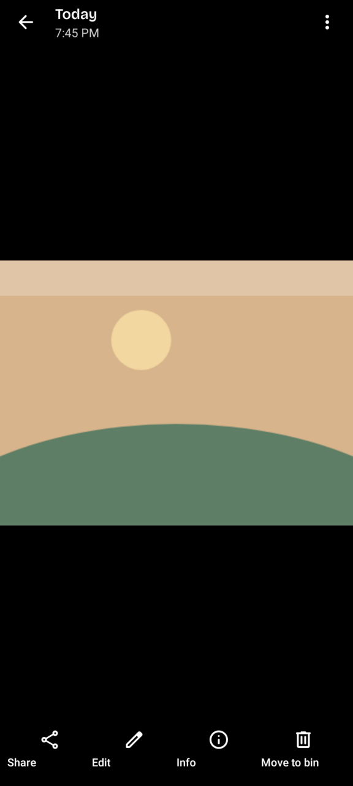
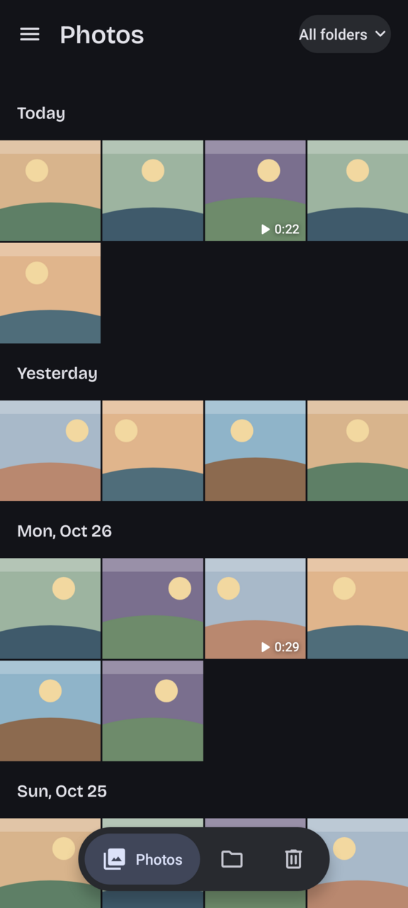
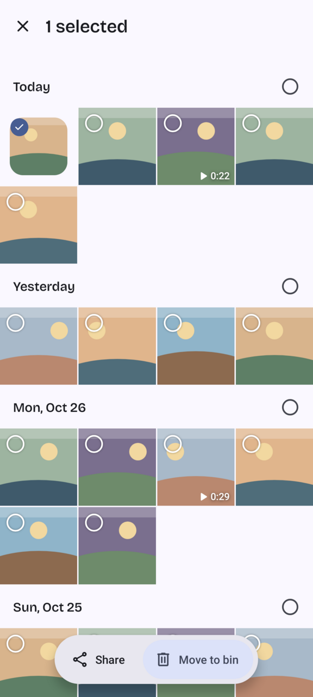
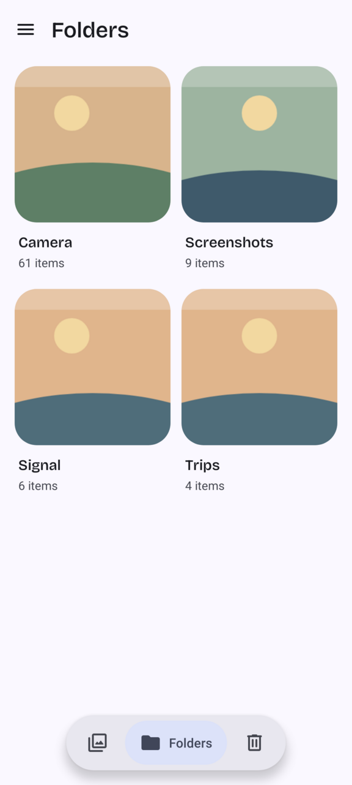
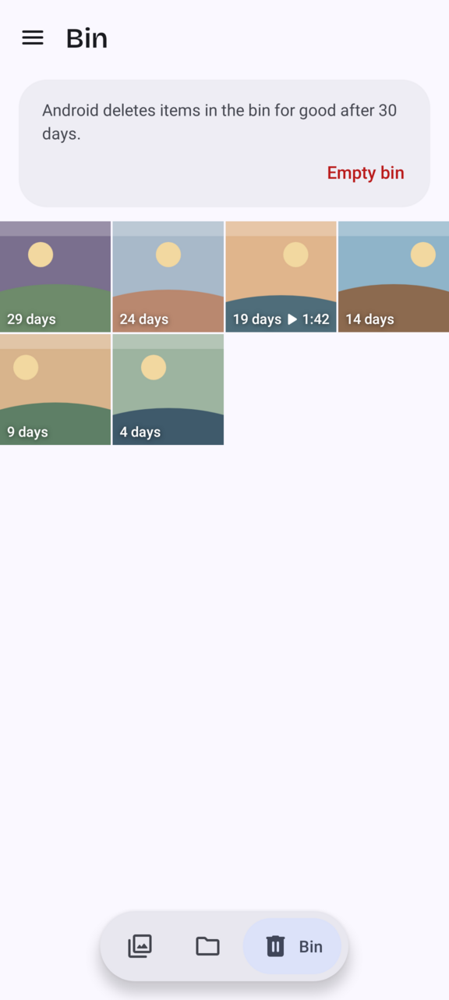
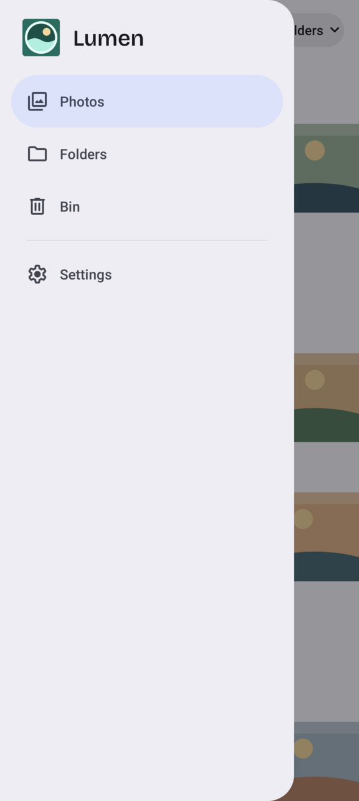

<p align="center"></p>

<h1 align="center">Lumen</h1>

<p align="center">A private photo gallery for Android, laid out like Google Photos.<br>
No internet permission, no tracking, no cloud. Made for GrapheneOS on Pixel phones.</p>

<p align="center">




</p>
<p align="center">




</p>

---

## What it does

- **Photos**: everything on your phone, newest first, grouped by day (Today, Yesterday, Sat 17 Oct).
  Pinch to change the thumbnail size; zoomed out far enough it groups by month.
  Drag the handle on the right edge to scrub through time.
- **Folder filter**: the chip at the top ("All folders") lets you pick one or more folders.
  Showing everything is the default, and your choice is remembered.
- **Folders**: every folder with a cover and a count. Tap one to see only that folder.
- **Viewer**: swipe between photos, pinch or double-tap to zoom, swipe down to close,
  swipe up for details (date, file, size, camera settings, location if you allow it).
  Videos play inline. Share, edit with another app, or move to the bin.
- **Camera thumbnail**: tap the round preview in Pixel Camera and Lumen opens the photo you
  just took. Swipe to see older shots.
- **Locked phone**: from the lock screen, Lumen only shows the photos of that camera session.
  Unlock to see the rest of your library.
- **Bin**: Android's own trash. Each item shows its days left before Android deletes it for good
  (30 days). Restore, delete forever, or empty the bin.
- **Selection**: long-press, then drag across thumbnails to select many at once.
- Material You colours from your wallpaper, light and dark mode, optional pure black.

## Why Lumen is installed as `com.google.android.apps.photos`

Pixel Camera doesn't ask Android for "any gallery". It only opens its thumbnail in an app
installed under Google Photos' package name, otherwise it asks you to install Google Photos.
So Lumen uses that package name. Everything you see says "Lumen", and the app is signed with its
own key, not Google's.

What that means for you:

- Lumen can't be installed next to the real Google Photos. Uninstall or disable Google Photos first.
- Lumen uses a very high version number, so the Play Store never offers a Google Photos
  "update" for it.

## Install

1. Download `Lumen-x.y.z.apk` from [Releases](../../releases).
2. Open it on your phone and allow your browser or file manager to install apps when asked.
3. Open Lumen and tap **Allow access** (photos and videos).
4. Optional: in the Bin tab tap **Turn on** next to "Skip the confirmation each time"
   (Android's "Media management" access). Without it, Android asks you to confirm every move
   to or from the bin.

Updates must be signed with the same key as the version you have installed. Official releases
are signed with this certificate (SHA-256):

```
EF:9F:5B:1D:78:D7:F4:26:79:E1:DA:F7:B4:79:34:38:E4:70:D9:82:56:2F:76:5B:40:0C:13:98:D5:09:01:5E
```

Check a download with `apksigner verify --print-certs Lumen-x.y.z.apk`, or with
[AppVerifier](https://github.com/soupslurpr/AppVerifier) on the phone.

## Privacy

- No Google services: no Play Services, Firebase, analytics or crash-reporting SDKs. The package
  name is the only Google thing about it (see above).
- No `INTERNET` permission. Lumen can't send anything anywhere, even if it wanted to.
- No ads, no accounts, no third-party libraries in the app (only Kotlin's standard library).
- If Lumen crashes, the error report is saved on the phone and shown next time with a Copy button.
  It's never sent anywhere.
- Lumen never copies or uploads your photos. It reads them through Android's media database,
  and moving to the bin, restoring and deleting all go through Android's own confirmation screens.
- Photo locations are only read after you tap "Show location" and allow it.

## Build from source

Needs JDK 17 or newer and the Android SDK (platform 36). Point `local.properties` at the SDK
(`sdk.dir=/path/to/android-sdk`), then:

```sh
./gradlew testDebugUnitTest       # logic tests, and screenshot tests of the main screens
./gradlew recordRoborazziDebug    # re-record the screenshots in app/src/test/screenshots
./gradlew assembleRelease         # app/build/outputs/apk/release/app-release.apk
```

Without a key the release build is signed with the debug key, which can't update an installed
release. To sign with your own key:

```sh
LUMEN_KEYSTORE=/path/to/key.jks LUMEN_KEYSTORE_PASSWORD=... LUMEN_KEY_ALIAS=lumen ./gradlew assembleRelease
```

## Project layout

| Path | What's in it |
| --- | --- |
| `core/` | Pure Kotlin logic with unit tests: date grouping, folder filter, bin countdown, selection, formatting, camera request handling |
| `data/` | Reading photos from Android's media database, thumbnails, settings |
| `grid/` | The photo grid: rows, thumbnails, pinch to resize, drag to select, fast scroller |
| `viewer/` | Full-screen viewer, swipe pager, zoomable image, video player, details panel |
| `ui/` | Colours, fonts, the floating navigation pill, bottom sheet, small helpers |
| `compat/` | The only place that uses APIs newer than Android 12 |
| `MainActivity`, `FolderActivity`, `SettingsActivity` | The screens |
| `app/src/test/` | Logic tests, plus screenshot tests that run the real screens on a fake photo library (the pictures above come from them) |

Requires Android 12 or newer. Built for and targets Android 16.

## Credits

- Made by [RealKHFan](https://github.com/RealKHFan), with help from Claude (Anthropic).
- The camera hand-off idea comes from [GCam Services Provider](https://github.com/lukaspieper/Gcam-Services-Provider)
  and CalyxOS's GCamPhotosPreview.
- Icons: [Material Symbols](https://github.com/google/material-design-icons), Apache License 2.0.
- Date and title font: [Bricolage Grotesque](https://github.com/ateliertriay/bricolage), SIL Open Font License 1.1.

## License

Lumen is free software under the [GNU General Public License v3.0 or later](LICENSE).
